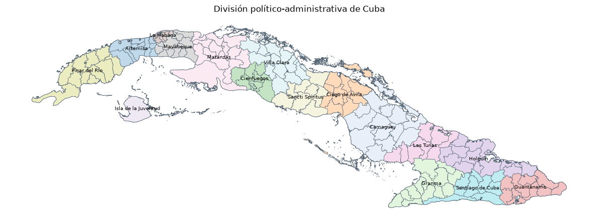
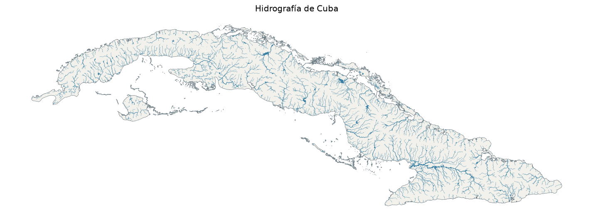

# Cuba Geographic Data

Open geographic datasets for Cuba, compiled from authoritative and openly available
sources for GIS, spatial analysis and programmatic use.

## Administrative data

Names, codes, relationships and geometry for Cuba’s **15 provinces, 167 ordinary
municipalities and the special municipality of Isla de la Juventud**, following
the official **Codificador de la División Político-Administrativa (CoDPA)**.

[Administrative Geographic Names](data/administrative-geographic-names/) — 183 name records with CoDPA codes, province relationships, point locations and source cross-references. **CC BY 4.0.**

[Administrative Geometry](data/administrative-geometry/) — 183 administrative polygon records linked to the geographic names. Province and municipality areas overlap by design. **ODbL 1.0.**

Explore the [names and hierarchy](examples/administrative_geographic_names.ipynb)
or [create the administrative map](examples/administrative_map.ipynb).

## Hydrographic data

Consolidated geographic names, modelled river and channel networks, catchments
and water-body polygons. Names and geometry are independent products connected
through direct identifiers; detailed feature types distinguish streams, canals,
channels, ditches, lakes, lagoons, reservoirs and other water features.

[Water Geographic Names](data/water-geographic-names/) — 3,687 consolidated objects with preferred names, recorded alternatives, detailed types and source references. **ODbL 1.0.**

[River and Channel Centerlines](data/river-centerlines/) — 56,594 reaches with drainage topology, stream order, direct name references and naming status, including explicit uncertain and withheld assignments. **ODbL 1.0.**

[River Catchments](data/river-catchments/) — 56,594 reach-linked polygons. Source ring defects were repaired without boundary displacement; source limitations remain documented. **CC BY 4.0.**

[Water-body Geometry](data/water-body-geometry/) — 1,148 HydroLAKES polygons with physical attributes and direct name references. Detailed named feature types are in the names registry. **CC BY 4.0.**

[Supplementary Water Geometry](data/supplementary-water-geometry/) — 372 observations representing 370 source features outside reference coverage. Multiple observations retain their source identities. **ODbL 1.0.**

Explore [water geographic names](examples/water_geographic_names.ipynb),
[create the hydrography map and count drainage systems](examples/hydrography_map.ipynb),
or [map systems associated with ONEI’s river list](examples/onei_river_systems.ipynb).

## Coastline and land polygons

Complementary line and polygon products derived from the project’s nonmarine
classification. The polygon footprint includes islands and inland water.

[Coastline](data/coastline/) — The full land-polygon boundary, including exterior rings and boundaries around interior holes. **ODbL 1.0.**

[Land Polygons](data/land-polygons/) — Nonmarine polygon footprint for coverage, masking and map backgrounds. **ODbL 1.0.**

Both layers provide the geographic context used in the hydrography map above.
Their derivation and resolution are documented in the product metadata.

## Reference tables

Readable CSV tables provide names, geographic context and identifiers for dataset
lookup. See [reading guidance and limitations](reference/README.md).

- [Administrative geographic names](reference/cuba_administrative_geographic_names.csv)
- [Water names](reference/cuba_water_names_reference.csv)
- [ONEI river correspondence](reference/cuba_onei_river_correspondence.csv)

ONEI correspondences and the example’s course selections are inferred associations;
they are not independently verified river identities.

## Formats and documentation

Spatial datasets are available as **GeoParquet, GeoJSON and GeoPackage**. Water
Geographic Names is available as **Parquet, CSV and GeoPackage attributes**.
River-centerline GeoJSON and GeoPackage files, and all three river-catchment
formats, use **gzip compression** (`.gz`). Product READMEs link to the files.

Each data folder includes a README, field definitions, ISO 19115-3 metadata and
SHA-256 checksums. All nine product metadata files pass XML Schema validation.
The self-contained notebooks in [`examples/`](examples/) demonstrate loading,
linking, exploring and mapping the datasets.

- [Data development](docs/data_development.md)
- [Source references](docs/references.md)
- [Contributing](docs/contributing.md)

## Release status and citation

**v1.0.0 covers the original administrative datasets.** The hydrographic and
coastal products are present in the repository; their release version and DOI
have not yet been assigned.

- **Version 1.0.0:** [10.5281/zenodo.22927748](https://doi.org/10.5281/zenodo.22927748).
- **Project, all versions:** [10.5281/zenodo.22927747](https://doi.org/10.5281/zenodo.22927747), also used by the badge above.

See [CITATION.cff](CITATION.cff) for the released citation metadata.

## License

**CC BY 4.0** is the default. Products identified above as **ODbL 1.0** retain
that license across all formats; the hydrography reference CSVs are also ODbL 1.0.
See [LICENSE.md](LICENSE.md), [reference-table terms](reference/LICENSE.md) and
individual product metadata for attribution and license details.

## Support

This is an independent project. If you find it useful and would like to support
the work behind it, you can [buy me a coffee](https://buymeacoffee.com/NotTheMapGuy).
